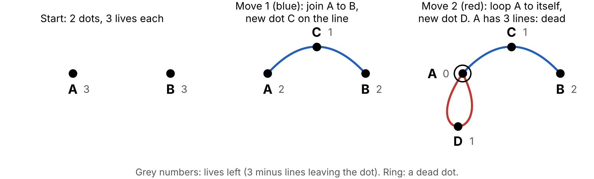

# Home plan: Sprouts

Sunday, November 8, 2026, at the kitchen table: James with Jay, Rose and perhaps a third child. **Untried:** nobody has played this plan yet, and every time is a guess.

## What you're doing

You play a pencil game called Sprouts. Draw two or three dots. Players take turns drawing a line from a dot to a dot (or back to the same dot) and putting a new dot on that line. Lines may not cross, and a dot with three lines leaving it is dead. Whoever cannot move loses. Rose has a one-dot game she always wins by going second, and she is the dead-dot spotter. Jay hunts for the longest and shortest games and finds out why a game with n dots can never last more than 3n − 1 moves, by giving every dot three "lives". You need paper and two pens of different colours. Play 20 to 30 minutes and stop whenever.

## The rules

- Start with a few dots, a hand-width apart.
- On your turn, draw a line from one dot to another, or a loop from a dot back to itself. Then put a new dot anywhere along your line (not on its ends).
- A line may bend and go round other dots and lines, but may not cross itself or another line, and may not pass through a dot.
- A dot can have at most 3 lines leaving it. Count a loop as 2 at its dot, and a new dot as 2 already (one each way along the line it sits on), so it can take one more. So a loop needs a dot with room for 2 more.
- If you cannot move, you lose. Said the other way: whoever makes the last move wins.
- Each player draws in their own colour, so you can see afterwards who did what.

**Lives.** Think of every dot as having 3 lives, and every line leaving it as using one. A dot with 0 lives is dead: draw a ring round it so nobody tries to use it. A new dot has 1 life.

**Counting moves.** No tally is needed: every move adds one dot, so the number of moves is the number of new dots.

## The mathematics, for you

1. **Every game ends, within 3n − 1 moves (n = starting dots).** *Proof.* The dots start with 3n lives. A move uses 2 lives (its two line ends) and adds a dot with 1 life, so the total drops by exactly 1 each move. After m moves there are 3n − m lives. The newest dot always has a life (nothing has been drawn since it was made), so the total never reaches 0, and m ≤ 3n − 1. A check you can use at the table: moves made + lives left = 3n, always. *Limits:* the count needs exactly 3 lives. With 4 lives a new dot keeps 2 and the total never drops, and the newest dot can loop for ever.
2. **Every game lasts at least 2n moves.** *Proof sketch, only for the keen.* At the end each live dot has exactly 1 life and shares no region with another live dot. Each live dot then has two dead neighbours (dots joined to it by a piece of line) that no other live dot touches; a dead dot has three pieces, and any two border one region, so it can't serve two live dots. (If a live dot sits on a loop, its two dead dots are the loop's dot and that dot's third neighbour.) So 3 × (live dots) ≤ all dots = n + m, and live dots = 3n − m gives m ≥ 2n.
3. **What actually happens** (computer search in our checker). 1 dot: always exactly 2 moves, so the second player wins whatever anyone does. 2 dots: 4 or 5 moves; the second player wins with best play. 3 dots: 6, 7 or 8 moves; the first player wins with best play, and we know no short rule for how. For 1 to 3 dots, every length from 2n to 3n − 1 happens. Since moves = 3n − (dots alive at the end), the game is really a fight over how many dots survive: an odd number of moves means the first player made the last one. Cited, not rechecked: 4 and 5 dots are first-player wins and 6 a second-player win (Applegate, Jacobson and Sleator, 1991, by computer), and nobody has proved a pattern. Sources: Conway and Paterson invented Sprouts (1967); Gardner, *Mathematical Carnival*, chapter 1; Berlekamp, Conway and Guy, *Winning Ways*, chapter 17. Our checker, [src/sprouts_check.py](src/sprouts_check.py), verifies every other fact here.
4. **Your strategy going second on 2 dots** (dots A and B; the new dots are C, D, ...).
   - If they join A to B: **join A to B again.** That makes a closed circle of four dots, one life each. Whatever two of those dots they join next, **join the other two, on the other side of the circle.** The game is over after 4 moves, and you made the last one.
   - If they loop A (or B): **join that dot to the new dot on its loop, on the side away from the other dot.** The other dot is then on its own, it takes exactly two more moves, and you make the second.

**What children might find.** By experiment: games always end; the same start gives games of different lengths; one dot is always 2 moves. As conjectures: "2 dots never takes more than 5", "second wins with 1 dot". As explanations: lives, which settle the longest game for any number of dots. The shortest-game proof is harder; most children stop at "it seems to be at least 2n".

## Materials and setup (2 minutes)

- Plain paper, one game per half sheet, and two pens of different colours per game. Rose may prefer a fat marker.
- Spread the starting dots a hand-width (about 5 cm) apart, so lines have room.
- Sit side by side so everyone sees the drawing the same way up.

## The route

Each part stands alone. Stop after any of them and pick up anywhere next time.

**1. Launch (3 minutes).** Draw two dots. Play the two moves in the picture yourself, saying the rules as you go: "a line, then a new dot on it"; "A has three lines now, so I ring it: it's dead." Let Jay and Rose finish that game against each other. Say only whether a move is allowed. *Watch for* a forgotten new dot, a line through a dot, and a loop counted as one line instead of two.

**2. Rose's part (5 to 10 minutes).**

- *One dot, she goes second.* You loop the dot. She joins the dot to your new dot, and the game is over: she wins. It always goes this way, whatever anyone draws. Play it a few times, then ask "With one dot, would you rather go first or second?" Then she can challenge Jay to it, telling him "You go first."
- *Dead-dot spotter.* In Jay's games, she checks each dot by touching the lines leaving it ("one, two, three: dead") and rings dead dots. If anyone disagrees, count together.
- *Two dots, as a team.* She teams with Jay or with you; she picks where the new dot goes.

*Rose's moment:* she wins the one-dot game knowing she will before it starts, or catches a live dot everyone else thought was dead. *Stop* when she would rather draw.

**3. Jay's part (10 to 20 minutes).** Ask one question at a time and let him play to find out.

- *Longest and shortest.* "Playing together, not against each other: what's the longest 2-dot game you can make? The shortest?" (5 and 4.)
- *Why.* "Why can't you make 6? Could a game go on for ever?" Hint if asked: "Give every dot 3 lives. What does one move do to the total?" To find: the total drops by 1; the newest dot always keeps a life; so at most 6 − 1 = 5.
- *Predict.* "Before we play 3 dots: longest? shortest?" (8 and 6.) Then "10 dots?" (29 and 20.) Play a 3-dot game to check the longest.
- *Beat me on 2 dots.* He chooses who goes first; going second, use the strategy above. If he loses twice, ask "What did I do after your first move?"
- *Who wins? Count from the end.* After a few 2-dot games: "When one dot was left alive, how many moves did it take? When two were left?" (5 and 4: moves = 3n − dots alive.) Odd means the first player made the last move, so the fight is over how many dots survive.

Only if he is keen: "Why can't a 3-dot game end in 5 moves?" Hint if asked: "At the end, look at a dot that's still alive. What is next to it?" The proof is item 2 above; reaching "every live dot has its own dead neighbours" is plenty.

**4. Closing questions (open).**

- "On 3 dots, would you rather go first or second?" (First, by computer; nobody knows a simple way to say how.)
- "What if every dot had 4 lives instead of 3? Does a game still have to end?" (No: the newest dot can loop for ever.)

**When to stop.** On a high point: Rose's win, or Jay's reason why 5 is the most. Next time, start with "Beat me on 2 dots" or with 3 dots.

## How it went

(Add a dated line after the weekend.)
